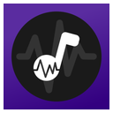
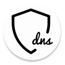
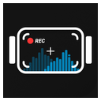
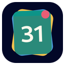
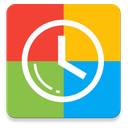

# Awesome Android FOSS 

<!-- This file is generated by scripts/build-readme.js from data/apps.yml.
     Edit templates/README.template.md or data/*.yml instead, then run `npm run build`. -->

<!--lint disable table-pipe-alignment table-cell-padding-->

> A curated, self-updating collection of free and open source Android apps. No ads, no trackers, no lock-in.

Every app on this list is open source and ships a real Android build. A weekly bot discovers new apps on GitHub, checks that each one is an actual Android application (not a library or another list), sorts it into a category, and keeps stars, install links and icons up to date. See [how it works](GUIDE.md).

**Legend:**  on F-Droid ·  on IzzyOnDroid ·  APK on GitHub Releases · 💤 no commits in over a year · 🗄️ archived

## Contents

- [Recently Added](#recently-added)
- [🔒 Privacy & Security](#-privacy--security) (10)
- [💬 Communication](#-communication) (4)
- [🌐 Browsers & Internet](#-browsers--internet) (3)
- [🎵 Music & Audio](#-music--audio) (8)
- [🎬 Video & Streaming](#-video--streaming) (7)
- [📷 Photos & Camera](#-photos--camera) (5)
- [📝 Productivity & Office](#-productivity--office) (10)
- [📚 Reading & News](#-reading--news) (2)
- [💪 Health & Fitness](#-health--fitness) (6)
- [🚀 Launchers & Customization](#-launchers--customization) (15)
- [📦 App Stores & Updaters](#-app-stores--updaters) (3)
- [🤖 AI & Assistants](#-ai--assistants) (5)
- [🏠 Cloud & Self-Hosted](#-cloud--self-hosted) (4)
- [💻 Development & Terminal](#-development--terminal) (2)
- [🧰 System & Utilities](#-system--utilities) (7)
- [🌱 Lifestyle & Education](#-lifestyle--education) (3)
- [💰 Finance & Crypto](#-finance--crypto) (1)
- [🎮 Games](#-games) (2)

## Recently Added

<table>
<tr>
<td align="center" width="16%"><a href="https://github.com/Soodok/Deepseek-Harness-Local-Android"> <b>DeepSeek Harness</b></a> 🤖 2026-10-18</td>
<td align="center" width="16%"><a href="https://github.com/FossifyOrg/Documents"> <b>Fossify Documents</b></a> 📝 2026-10-11</td>
<td align="center" width="16%"><a href="https://github.com/N-Zik-Group/N-Zik"> <b>N-Zik</b></a> 🎵 2026-10-11</td>
<td align="center" width="16%"><a href="https://github.com/yuxino/Mimi"> <b>Mimi</b></a> 🎬 2026-10-04</td>
<td align="center" width="16%"><a href="https://github.com/Earendel-lab/Tapbar"> <b>Tapbar</b></a> 🚀 2026-10-04</td>
<td align="center" width="16%"><a href="https://github.com/abduznik/Freegosy"> <b>Freegosy</b></a> 🏠 2026-09-27</td>
</tr>
</table>

## 🔒 Privacy & Security

*Firewalls, ad and tracker blockers, VPN/DNS clients, password managers and vaults.*

| | App | Description | Get it |
|:-:|:--|:--|:--|
|  | **[KeePassDX](https://github.com/Kunzisoft/KeePassDX)** ⭐ 7.5k · GPL-3.0 | Password manager and vault for KeePass databases, with autofill and passkeys. |   |
|  | **[Rethink](https://github.com/celzero/rethink-app)** ⭐ 5.6k · Apache-2.0 | DNS-over-HTTPS/Tor/DNSCrypt client, WireGuard proxifier and per-app firewall in one. |  |
|  | **[NetGuard](https://github.com/M66B/NetGuard)** ⭐ 3.9k · GPL-3.0 | Block internet access per app without root, with optional traffic logging and filtering. |   |
|  | **[TrackerControl](https://github.com/TrackerControl/tracker-control-android)** ⭐ 2.7k · GPL-3.0 | Monitor and block the trackers and ads embedded in your apps. |  |
|  | **[Monica](https://github.com/Monica-Pass/Monica)** ⭐ 1.2k · GPL-3.0 | Password manager and 2FA code generator. |  |
|  | **[Plexus](https://github.com/techlore/Plexus-app)** ⭐ 498 · GPL-3.0 | Crowd-sourced app compatibility ratings for de-Googled and microG devices. |   |
|  | **[Privacium](https://github.com/kaleedtc/Privacium)** ⭐ 300 · MIT | Discover privacy-respecting alternatives to popular apps and services. |  |
|  | **[IYPS](https://github.com/StellarSand/IYPS)** ⭐ 283 · GPL-3.0 | Rates how strong your passwords are, estimates crack time and suggests improvements. |   |
|  | **[Calculator Vault](https://github.com/Binondi/Calculator-Hide-Files)** ⭐ 214 · Apache-2.0 | A working calculator that doubles as an AES-encrypted vault for photos, videos and documents. |  |
|  | **[Password Monitor](https://github.com/StellarSand/Password-Monitor)** ⭐ 123 · GPL-3.0 | Check whether your passwords have appeared in known data breaches. |   |

<a href="#contents">⬆ Back to contents</a>

## 💬 Communication

*Messaging, calls, SMS, contacts and email.*

| | App | Description | Get it |
|:-:|:--|:--|:--|
|  | **[Fossify Messages](https://github.com/FossifyOrg/Messages)** ⭐ 1.6k · GPL-3.0 | Fast SMS and MMS messaging with no ads. |   |
|  | **[Fossify Phone](https://github.com/FossifyOrg/Phone)** ⭐ 1.4k · GPL-3.0 | Dialer with phonebook, call blocking and multi-SIM support. |   |
|  | **[Fossify Contacts](https://github.com/FossifyOrg/Contacts)** ⭐ 929 · GPL-3.0 | Contact manager with groups and favourites, no ads. |   |
|  | **[Nextcloud Talk](https://github.com/nextcloud/talk-android)** ⭐ 747 | Chat plus video and audio calls through your Nextcloud server. |  |

<a href="#contents">⬆ Back to contents</a>

## 🌐 Browsers & Internet

*Web browsers, downloaders and network tools.*

| | App | Description | Get it |
|:-:|:--|:--|:--|
|  | **[DashBeam](https://github.com/tonyantony300/dashbeam)** ⭐ 10k · AGPL-3.0 | Send files and folders to devices nearby or anywhere, peer-to-peer. Formerly AltSendme. |  |
|  | **[Relay](https://github.com/Mahdi-mortazavi/relay)** ⭐ 219 · GPL-3.0 | Share your phone's internet with a Windows PC through an encrypted WireGuard tunnel, no root. |  |
|  | **[Tor Browser](https://www.torproject.org/download/#android)** | Browse privately through the Tor network, with tracker blocking and fingerprinting protection. |  |

<a href="#contents">⬆ Back to contents</a>

## 🎵 Music & Audio

*Music players, streaming clients, podcasts, radio and recorders.*

| | App | Description | Get it |
|:-:|:--|:--|:--|
|  | **[Stash](https://github.com/rawnaldclark/Stash)** ⭐ 1.4k · GPL-3.0 | Brings your Spotify and YouTube Music libraries and daily mixes into one free player. |  |
|  | **[Tempus](https://github.com/eddyizm/tempus)** ⭐ 1.4k · GPL-3.0 | Lightweight native client for Subsonic-compatible music servers. |  |
|  | **[Fossify Voice Recorder](https://github.com/FossifyOrg/Voice-Recorder)** ⭐ 1k · GPL-3.0 | Record conversations and sounds without ads or internet access. |   |
|  | **[Fossify Music Player](https://github.com/FossifyOrg/Music-Player)** ⭐ 947 · GPL-3.0 | Clean music player with a customisable widget and no ads. |   |
|  | **[Melodia](https://github.com/rinchao0721/Melodia)** ⭐ 287 · MIT | Lightweight third-party NetEase Cloud Music client with a Spotify-inspired UI. |  |
|  | **[N-Zik](https://github.com/N-Zik-Group/N-Zik)** ⭐ 266 · GPL-3.0 | Multilingual YouTube Music front-end focused on performance and polish. |  |
|  | **[Resonus](https://github.com/juananzzz/resonus)** ⭐ 204 · GPL-3.0 | Music player for self-hosted servers (Subsonic, Navidrome, Ampache) and local files. |  |
|  | **[Internet Radio](https://github.com/armanmaurya/InternetRadio)** ⭐ 153 · GPL-3.0 | Discover and listen to thousands of free internet radio stations worldwide. |  |

<a href="#contents">⬆ Back to contents</a>

## 🎬 Video & Streaming

*Video players, YouTube and IPTV clients.*

| | App | Description | Get it |
|:-:|:--|:--|:--|
|  | **[NewPipe](https://github.com/TeamNewPipe/NewPipe)** ⭐ 40k · GPL-3.0 | Lightweight YouTube front-end with background play, downloads and no Google services. |   |
|  | **[Nova Video Player](https://github.com/nova-video-player/aos-AVP)** ⭐ 4.7k · Apache-2.0 | Video player with a media-centre UI, network shares (SMB/UPnP) and automatic metadata. |   |
|  | **[VLC](https://github.com/videolan/vlc-android)** ⭐ 4.1k · GPL-2.0 | The VLC media player: plays almost any video or audio format, network streams and discs. |  |
|  | **[Flow](https://github.com/Flow-Tube/Flow)** ⭐ 2.9k · GPL-3.0 | YouTube and YouTube Music client with on-device recommendations, built with Jetpack Compose. |  |
|  | **[Mimi](https://github.com/yuxino/Mimi)** ⭐ 723 · MIT | Live translated subtitles for any audio playing on your device or from the microphone. |  |
|  | **[OwnTV](https://github.com/ahXN00/OwnTV)** ⭐ 608 · GPL-3.0 | IPTV player for Android TV supporting Xtream, M3U and Stalker portals with EPG and catch-up. |  |
|  | **[mpv∞](https://github.com/ZHINFINITY/Mpv-infinity)** ⭐ 137 | Ad-free media player powered by mpv and Media3, with HDR and Jellyfin support. |  |

<a href="#contents">⬆ Back to contents</a>

## 📷 Photos & Camera

*Galleries, cameras, photo editors and drawing apps.*

| | App | Description | Get it |
|:-:|:--|:--|:--|
|  | **[Fossify Gallery](https://github.com/FossifyOrg/Gallery)** ⭐ 3.8k · GPL-3.0 | Photo and video gallery with editing, hidden folders and no unnecessary permissions. |   |
|  | **[Fossify Camera](https://github.com/FossifyOrg/Camera)** ⭐ 476 · GPL-3.0 | Quick photo and video camera with flash control and custom aspect ratios. |   |
|  | **[OpenPocketCine](https://github.com/erik-sutton95/OpenPocketCine)** ⭐ 343 · Apache-2.0 | Field monitor app for DJI Osmo Pocket cameras. |  |
|  | **[Fossify Paint](https://github.com/FossifyOrg/Paint)** ⭐ 317 · GPL-3.0 | A simple canvas for drawing and sketching. |   |
|  | **[PiPixiv](https://github.com/darriousliu/PiPixiv)** ⭐ 266 · Apache-2.0 | Third-party Pixiv client built with Compose Multiplatform. |  |

<a href="#contents">⬆ Back to contents</a>

## 📝 Productivity & Office

*Notes, tasks, calendars, documents, PDF and office tools.*

| | App | Description | Get it |
|:-:|:--|:--|:--|
|  | **[Super Productivity](https://github.com/super-productivity/super-productivity)** ⭐ 23k · MIT | To-do list with timeboxing, time tracking and Jira/GitHub/GitLab integrations. |  |
|  | **[Fossify Calendar](https://github.com/FossifyOrg/Calendar)** ⭐ 2.2k · GPL-3.0 | Calendar with events, CalDAV sync and customisable widgets. |   |
|  | **[Table Habit](https://github.com/FriesI23/mhabit)** ⭐ 1.7k · Apache-2.0 | Habit tracker with smart scoring, WebDAV sync and local-first storage. |   |
|  | **[PaperKnife](https://github.com/potatameister/PaperKnife)** ⭐ 1.5k · AGPL-3.0 | Merge, split, compress and edit PDFs entirely on your device. |  |
|  | **[PDF Toolkit](https://github.com/Karna14314/Pdf_Tools)** ⭐ 651 · Apache-2.0 | Offline PDF editor: merge, split, compress, convert and annotate on-device. |  |
|  | **[Fossify Notes](https://github.com/FossifyOrg/Notes)** ⭐ 504 · GPL-3.0 | Quick notes and checklists with widgets and no ads. |   |
|  | **[KashCal](https://github.com/KashCal/KashCal)** ⭐ 456 | Offline-first calendar that syncs iCloud, Nextcloud, Fastmail and any CalDAV server. |   |
|  | **[Timer Machine](https://github.com/timer-machine/timer-machine-android)** ⭐ 369 · GPL-3.0 | Highly customisable interval timer for workouts, cooking and studying. |  |
|  | **[Flux](https://github.com/chindaronit/Flux)** ⭐ 349 · GPL-3.0 | Flexible workspaces for notes, journals, tasks and events. |   |
|  | **[Fossify Documents](https://github.com/FossifyOrg/Documents)** ⭐ 186 · GPL-3.0 | Simple, clean viewer for your documents. |   |

<a href="#contents">⬆ Back to contents</a>

## 📚 Reading & News

*E-book and comic readers, RSS/news clients and book trackers.*

| | App | Description | Get it |
|:-:|:--|:--|:--|
|  | **[Openreads](https://github.com/mateusz-bak/openreads)** ⭐ 1.7k · GPL-2.0 | Track the books you have read, are reading and want to read. |  |
|  | **[Nextcloud News](https://github.com/nextcloud/news-android)** ⭐ 768 · AGPL-3.0 | RSS/Atom reader that syncs with the Nextcloud News app. |  |

<a href="#contents">⬆ Back to contents</a>

## 💪 Health & Fitness

*Workout, nutrition, sleep and wellbeing trackers.*

| | App | Description | Get it |
|:-:|:--|:--|:--|
|  | **[OpenNutriTracker](https://github.com/simonoppowa/OpenNutriTracker)** ⭐ 2.7k · GPL-3.0 | Simple, private calorie and nutrition tracker. |  |
|  | **[Fud AI](https://github.com/apoorvdarshan/fud-ai)** ⭐ 484 · MIT | AI-assisted calorie and workout tracker that works with your own API key. |  |
|  | **[Flexify](https://github.com/brandonp2412/Flexify)** ⭐ 449 · MIT | Offline workout tracker for strength and cardio with graphs and rest timers. |  |
|  | **[Quitter](https://github.com/brandonp2412/Quitter)** ⭐ 191 · MIT | Private addiction-recovery tracker with milestones and journaling. |  |
|  | **[FitBook](https://github.com/brandonp2412/FitBook)** ⭐ 176 · MIT | Offline calorie and macro tracker with barcode scanning and food search. |  |
|  | **[Caffeine Health](https://github.com/ohuc/CaffeineHealth)** ⭐ 146 · GPL-3.0 | Shows your live caffeine level and whether that late coffee will cost you sleep. |   |

<a href="#contents">⬆ Back to contents</a>

## 🚀 Launchers & Customization

*Home screen launchers, keyboards, wallpapers and theming tools.*

| | App | Description | Get it |
|:-:|:--|:--|:--|
|  | **[KISS Launcher](https://github.com/Neamar/KISS)** ⭐ 3.5k · GPL-3.0 | Blazing-fast search-first launcher under 250 KB. |  |
|  | **[Neo Launcher](https://github.com/NeoApplications/Neo-Launcher)** ⭐ 2.1k · GPL-3.0 | Modern, customisable launcher based on Launcher3 with Material You theming. |  |
|  | **[Fossify Launcher](https://github.com/FossifyOrg/Launcher)** ⭐ 713 · GPL-3.0 | Practical, customisable launcher for opening your favourite apps quickly. |   |
|  | **[Fossify Keyboard](https://github.com/FossifyOrg/Keyboard)** ⭐ 689 · GPL-3.0 | Simple keyboard for text, special characters and numbers. |   |
|  | **[Prism](https://github.com/Hash-Studios/Prism)** ⭐ 665 · BSD-3-Clause | Wallpapers and home-screen setups with curated collections. |  |
|  | **[Urik](https://github.com/urikdev/Urik)** ⭐ 413 · GPL-3.0 | Private keyboard with swipe typing, custom layouts and password manager support. |  |
|  | **[LTvLauncher](https://github.com/leanbitlab-org/LtvLauncher)** ⭐ 397 · GPL-3.0 | Minimal Android TV launcher with a data-usage widget and OLED screensaver. |  |
|  | **[mLauncher](https://github.com/CodeWorksCreativeHub/mLauncher)** ⭐ 308 · GPL-3.0 | Minimal text-based launcher, a customised fork of Olauncher. |   |
|  | **[Adaptive Theme](https://github.com/xLexip/Adaptive-Theme)** ⭐ 293 · GPL-3.0 | Automatically switches dark mode based on the ambient light sensor. |  |
|  | **[Mako](https://github.com/rama-io/mako)** ⭐ 273 · GPL-3.0 | Minimal, distraction-free launcher designed for focus. |  |
|  | **[Tapbar](https://github.com/Earendel-lab/Tapbar)** ⭐ 180 · MIT | Launch apps and quick actions from the status bar or anywhere on screen. |  |
|  | **[Launcher314](https://github.com/bearinmindcat/Launcher314)** ⭐ 178 · GPL-3.0 | Launcher with deep customisation on a single screen. |  |
|  | **[Undead Wallpaper](https://github.com/maocide/UndeadWallpaper)** ⭐ 145 · GPL-3.0 | Turn any video into a seamless live wallpaper. |  |
|  | **[Scribe](https://github.com/scribe-org/Scribe-Android)** ⭐ 109 · GPL-3.0 | Keyboards for language learners with translation and verb conjugation. |  |
|  | **[EasyLauncher](https://github.com/CodeWorksCreativeHub/EasyLauncher)** ⭐ 339 · GPL-3.0 · 🗄️ archived | Minimal, clutter-free launcher. |   |

<a href="#contents">⬆ Back to contents</a>

## 📦 App Stores & Updaters

*Alternative app stores, repo clients and update managers.*

| | App | Description | Get it |
|:-:|:--|:--|:--|
|  | **[Komi Store](https://github.com/komi-store/komi-store)** ⭐ 20k · Apache-2.0 | Browse and install apps released on GitHub, Codeberg and Forgejo, with update tracking. Formerly GitHub Store. |  |
|  | **[F-Droid](https://github.com/f-droid/fdroidclient)** ⭐ 3.2k · GPL-3.0 | The catalogue of free and open source Android apps, with updates and third-party repos. |  |
|  | **[SafeHaven Store](https://github.com/phsycologicalFudge/SafeHaven-Store)** ⭐ 211 · MIT | Alternative app store offering verified open source apps with built-in malware scanning. |  |

<a href="#contents">⬆ Back to contents</a>

## 🤖 AI & Assistants

*On-device and self-hosted LLM clients and voice assistants.*

| | App | Description | Get it |
|:-:|:--|:--|:--|
|  | **[ToolNeuron](https://github.com/Siddhesh2377/ToolNeuron)** ⭐ 475 · MIT | Encrypted, offline AI suite: chat with local GGUF models, and more, fully on-device. |  |
|  | **[Hermes Relay](https://github.com/Codename-11/hermes-relay)** ⭐ 361 · MIT | Chat with, talk to and control your Hermes AI agent from your phone. |  |
|  | **[Miffan](https://github.com/Ayuilos/Miffan)** ⭐ 326 · AGPL-3.0 | AI chat client (RikkaHub fork) with ChatGPT login, floating translation and IM-style mode. |  |
|  | **[OpenClaw Assistant](https://github.com/yuga-hashimoto/openclaw-assistant)** ⭐ 324 · MIT | Voice assistant for OpenClaw with wake-word activation and system assistant integration. |  |
|  | **[DeepSeek Harness](https://github.com/Soodok/Deepseek-Harness-Local-Android)** ⭐ 303 · MIT | Runs the DeepSeek Harness AI agent natively, without root or Termux. |  |

<a href="#contents">⬆ Back to contents</a>

## 🏠 Cloud & Self-Hosted

*Clients for Nextcloud, Home Assistant and other self-hosted services.*

| | App | Description | Get it |
|:-:|:--|:--|:--|
|  | **[Nextcloud](https://github.com/nextcloud/android)** ⭐ 5.6k · GPL-2.0 | Files client for your Nextcloud server with auto-upload and offline access. |  |
|  | **[nati.ve](https://github.com/Obiente/native)** ⭐ 722 · AGPL-3.0 | Adaptive native Nextcloud client with support for the wider Nextcloud app ecosystem. |  |
|  | **[Freegosy](https://github.com/abduznik/Freegosy)** ⭐ 243 · MIT | Browse your RomM game library, download games and sync saves with emulators. |  |
|  | **[Nextcloud Cookbook](https://github.com/lneugebauer/nextcloud-cookbook)** ⭐ 110 · MIT | Browse and cook from the recipes stored in your Nextcloud Cookbook. |  |

<a href="#contents">⬆ Back to contents</a>

## 💻 Development & Terminal

*Terminals, code editors, Git clients and developer utilities.*

| | App | Description | Get it |
|:-:|:--|:--|:--|
|  | **[Termux](https://github.com/termux/termux-app)** ⭐ 63k | Terminal emulator and Linux environment with a full package manager. |  |
|  | **[Klyx](https://github.com/klyx-dev/klyx)** ⭐ 165 · GPL-3.0 | Lightweight, high-performance code editor. |  |

<a href="#contents">⬆ Back to contents</a>

## 🧰 System & Utilities

*File managers, calculators, clocks, weather and other everyday tools.*

| | App | Description | Get it |
|:-:|:--|:--|:--|
|  | **[WeatherMaster](https://github.com/PranshulGG/WeatherMaster)** ⭐ 3.1k · GPL-3.0 | Material 3 weather app with multiple forecast sources. |  |
|  | **[Fossify File Manager](https://github.com/FossifyOrg/File-Manager)** ⭐ 1.8k · GPL-3.0 | Fast file manager with root browsing, archive support and no ads. |   |
|  | **[Fossify Clock](https://github.com/FossifyOrg/Clock)** ⭐ 712 · GPL-3.0 | Clock, alarm, stopwatch and timer with widgets. |   |
|  | **[OSS Weather](https://github.com/ossappscollective/oss-weather)** ⭐ 461 · MIT | Weather forecasts from multiple providers with widgets. |  |
|  | **[Fossify Calculator](https://github.com/FossifyOrg/Calculator)** ⭐ 454 · GPL-3.0 | Calculator for quick everyday maths with a clean interface. |   |
|  | **[HiLight Studio](https://github.com/DhananjayBhosale/hilight-studio)** ⭐ 366 · MIT | Experimental controller for the Pixel HiLight LED. |  |
|  | **[Fossify Flashlight](https://github.com/FossifyOrg/Flashlight)** ⭐ 153 · GPL-3.0 · 🗄️ archived | Flashlight with SOS, strobe and bright-display modes. |  |

<a href="#contents">⬆ Back to contents</a>

## 🌱 Lifestyle & Education

*Recipes, travel, maps, learning and community apps.*

| | App | Description | Get it |
|:-:|:--|:--|:--|
|  | **[Talawa](https://github.com/PalisadoesFoundation/talawa)** ⭐ 487 · GPL-3.0 | Manage community organisations: members, events, posts and chats. |  |
|  | **[Sabbath School](https://github.com/Adventech/sabbath-school-android)** ⭐ 198 · MIT | Daily Sabbath School lessons and Bible study guides. |  |
|  | **[Drinkable](https://github.com/MOIMOB/drinkable)** ⭐ 182 · MIT | Find cocktails you can make right now with what you have at home. |  |

<a href="#contents">⬆ Back to contents</a>

## 💰 Finance & Crypto

*Budgeting, expense tracking and self-custody wallets.*

| | App | Description | Get it |
|:-:|:--|:--|:--|
|  | **[Aura Wallet](https://github.com/aurabitcoinwallet/aura-wallet)** ⭐ 76 · MIT | Self-custody Bitcoin wallet. |  |

<a href="#contents">⬆ Back to contents</a>

## 🎮 Games

*Open source games and emulators.*

| | App | Description | Get it |
|:-:|:--|:--|:--|
|  | **[Lexica](https://github.com/lexica/lexica)** ⭐ 340 · GPL-3.0 | Find as many words as you can in a grid of letters before time runs out. |  |
|  | **[Puzzle](https://github.com/sidhant947/Puzzle)** ⭐ 262 · GPL-3.0 | A suite of 300+ minimalist puzzle games. |  |

<a href="#contents">⬆ Back to contents</a>

## Related Lists

- [android-foss](https://github.com/offa/android-foss) - Long-running list of FOSS Android apps, grouped by purpose.
- [F-Droid](https://f-droid.org/en/packages/) - The full catalogue of the main free software Android repository.
- [IzzyOnDroid](https://apt.izzysoft.de/fdroid/list/browse) - F-Droid compatible repository with thousands of additional FOSS apps.
- [Privacy Guides](https://www.privacyguides.org/en/android/) - Privacy-focused Android recommendations and guides.

## Contributing

Know an app that belongs here? Read the [contribution guidelines](CONTRIBUTING.md) or [suggest it in an issue](https://github.com/pronzzz/awesome-android-foss/issues/new?template=app-suggestion.yml).

 

